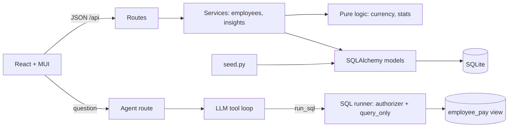

# Architecture & Trade-offs

**Layers.** Routes only translate HTTP <-> service calls. Services hold use-cases and raise domain errors
(`NotFoundError`, `DuplicateEmailError`) that `main.py` maps to 404/409. `currency.py` and `stats.py` are pure
functions, so the money maths is unit-tested with hand-computed values and no database.

## Decisions
| Decision | Why | Trade-off / next step |
|---|---|---|
| Currency derived from country server-side | Country and currency can never disagree | One currency per country; multi-currency payroll would need an explicit field |
| Integer annual salary in whole units | No float drift in stored money | No cents; fine for annual base pay |
| Static FX table | Deterministic tests, no external dependency | Rates drift; add a daily rate sync |
| Median **and** average shown | Averages hide skew; median answers "what does a typical person earn" | The UI calls out when they diverge |
| Insights aggregated in-process over 5 narrow columns | Exact median (SQLite has no MEDIAN), pure testable code, ~90 ms for 10k rows | At 1M+ rows move to SQL window functions / summary table |
| Sort by `salary_usd` computed in SQL (`CASE` on currency) | Sorting raw local amounts across currencies is misleading (5M INR is about 60k USD) | Not indexable; fine at this scale |
| Server-side pagination, filters and sorting | A 10k-row table must not ship to the browser | Substring search (`LIKE %q%`) cannot use an index; add FTS/trigram if it becomes slow |
| Soft delete (terminated) | Keeps history and keeps past numbers explainable | Terminated people are excluded from insights by design |
| SQLite | Zero-ops, per the brief | Single writer; swap `DATABASE_URL` for Postgres (SQLAlchemy code is portable) |
| API serves the built UI | One deployable, no CORS in production | Separate CDN hosting is easy later |

## Charts (Insights page)
Chart choices follow the job of the data, not decoration:

| Question | Form | Why |
|---|---|---|
| How does median pay compare across groups? | Horizontal bars, **one colour**, value at the bar end | Nominal categories: colour carries no extra meaning, so length does the work. Zero baseline keeps bar lengths honest |
| Where does the payroll budget go? | One 100% stacked bar (at most 8 coloured parts + Other) | Part-to-whole. A pie/donut with 8 slices is hard to compare. Not shown for job titles (24 titles would be noise); the table has every share |
| How many people earn in each band? | Columns in band order, one colour, count on top | Ordered buckets (a histogram) |
| What are the exact numbers? | Table (also the accessible equivalent of every chart) | Tooltips never gate information |

- **Palette validated, not eyeballed.** The 8 categorical colours were run through a validator (lightness band, chroma floor, colour-blind separation of neighbouring slots, contrast). My original teal failed the chroma check (it reads as grey), so the app accent was moved to the matching blue.
- **Colour follows the entity.** A country or department always gets the same slot (by sorted name), so sorting never repaints; beyond 8 entities the tail folds into a neutral "Other" instead of inventing a 9th hue.
- **Thin marks, hairline grid, labels outside the bars,** and a segment label is drawn only when it fits.
- **Config is plain code** (`chartConfigs.ts`), unit-tested, and was rendered to images with real data to check layout before shipping.
- Limitation: light theme only (no dark mode), and Chart.js canvas charts need the table as the screen-reader alternative.

## The "Ask the data" agent
Flow: question -> LLM (tools: `run_sql`) -> read-only SQL -> rows -> LLM -> answer. The UI shows the answer and the SQL.

| Concern | Control |
|---|---|
| Model writes or deletes data | SQLite **authorizer** denies everything except SELECT; `PRAGMA query_only=ON`; only one statement allowed |
| Model reads private columns (emails) or other tables | Authorizer allows reads only of the `employee_pay` view and `fx_rates`. The view has no email column. A CTE named like a real table cannot unlock it (tested) |
| Runaway or expensive queries | 2 s wall-clock timeout (progress handler), 50-row result cap, 5-step tool loop, 700 output tokens |
| Prompt injection via data (a job title saying "ignore your rules") | Prompt marks results as data; more importantly the *permissions* are enforced by the database, not by the prompt |
| Cost / abuse on a public URL | Sliding-window rate limit (default 60 questions/hour), 500-char question cap. Also set a monthly spend cap in the OpenAI dashboard |
| Wrong answers | SQL and result rows are always shown; the SQL medians were cross-checked against the Python insights medians |
| Tests need the network | LLM client is injected; tests use a scripted fake, so they are fast, free and deterministic |
| Data leaves the building | Query results (names, titles, salaries) go to OpenAI. Fine for a demo; production needs a DPA or a self-hosted model |

Why a SQL view: it gives the model a small, stable, documented surface (and SQL reviewers can read it),
instead of the raw schema. `fx_rates` is a real table so USD conversion is plain SQL in both the view and the app config.

## Performance (10,000 rows, local)
| Endpoint | Time |
|---|---|
| List page / search / filter / sort | 8-32 ms |
| Insights overview | ~90 ms |
| CSV export (all rows) | ~175 ms (was ~4.1 s when yielding row by row; chunking fixed it) |
| Seed 10,000 employees | ~1 s (bulk insert) |
| Agent SQL (median by country via window functions) | ~25 ms (LLM latency dominates, typically a few seconds) |

## Security (deliberately out of v1, see requirements)
Salary data is sensitive. Before real use: SSO + role-based access, audit log of reads/writes, HTTPS-only,
and encrypted backups.
