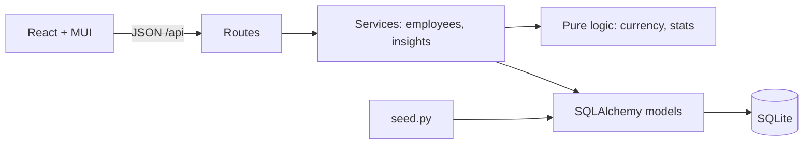

# Architecture & Trade-offs

**Layers.** Routes only translate HTTP <-> service calls. Services hold use-cases and raise domain errors
(`NotFoundError`, `DuplicateEmailError`) that `main.py` maps to 404/409. `currency.py` and `stats.py` are pure
functions, so the money maths is unit-tested with hand-computed values and no database.

## Decisions
| Decision | Why | Trade-off / next step |
|---|---|---|
| Currency derived from country server-side | Country and currency can never disagree | One currency per country; multi-currency payroll would need an explicit field |
| Integer annual salary in whole units | No float drift in stored money | No cents; fine for annual base pay |
| Static FX table | Deterministic tests, no external dependency | Rates drift; add a daily rate sync |
| Median **and** average shown | Averages hide skew; median answers "what does a typical person earn" | The UI calls out when they diverge |
| Insights aggregated in-process over 5 narrow columns | Exact median (SQLite has no MEDIAN), pure testable code, ~90 ms for 10k rows | At 1M+ rows move to SQL window functions / summary table |
| Sort by `salary_usd` computed in SQL (`CASE` on currency) | Sorting raw local amounts across currencies is misleading (5M INR is about 60k USD) | Not indexable; fine at this scale |
| Server-side pagination, filters and sorting | A 10k-row table must not ship to the browser | Substring search (`LIKE %q%`) cannot use an index; add FTS/trigram if it becomes slow |
| Soft delete (terminated) | Keeps history and keeps past numbers explainable | Terminated people are excluded from insights by design |
| SQLite | Zero-ops, per the brief | Single writer; swap `DATABASE_URL` for Postgres (SQLAlchemy code is portable) |
| API serves the built UI | One deployable, no CORS in production | Separate CDN hosting is easy later |

## Performance (10,000 rows, local)
| Endpoint | Time |
|---|---|
| List page / search / filter / sort | 8-32 ms |
| Insights overview | ~90 ms |
| CSV export (all rows) | ~175 ms (was ~4.1 s when yielding row by row; chunking fixed it) |
| Seed 10,000 employees | ~1 s (bulk insert) |

## Security (deliberately out of v1, see requirements)
Salary data is sensitive. Before real use: SSO + role-based access, audit log of reads/writes, HTTPS-only,
and encrypted backups.
